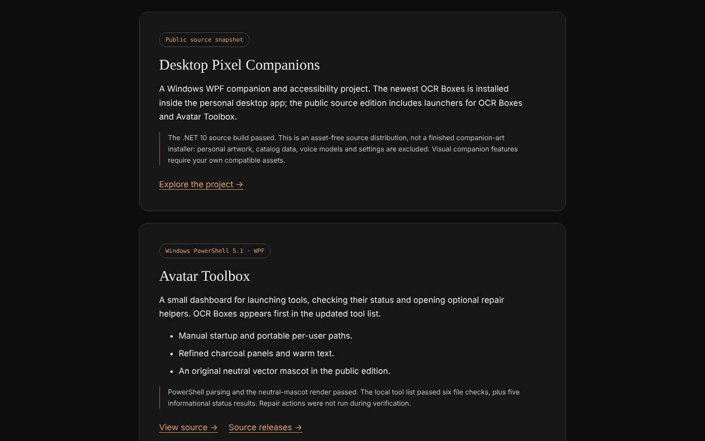

# Desktop Pixel Companions

**A Windows desktop companion and accessibility project, shared as source.**

[**▶ Project page on caseyshingledecker.com**](https://caseyshingledecker.com/desktop-tools.html#desktop-pixel-companions) · [**Source**](https://github.com/Beebopcat/desktop-pixel-companions)



## What it is

A Windows WPF desktop companion and accessibility project. This public edition is an asset-free source snapshot that separates the application code from the author's personal artwork, voice models, settings and reports. It includes launchers for OCR Boxes and the neutral Avatar Toolbox.

## Screenshots


<sub>Desktop Tools page at the Desktop Pixel Companions card, with its source-snapshot note and Explore the project link.</sub>

## How to use

1. Build the project with `dotnet build app/AzerothCompanion.csproj -c Release` (targets .NET 10, Windows).
2. OCR Boxes and the neutral Avatar Toolbox can be run separately by following their own READMEs.
3. Visual companion features need your own compatible artwork and catalog data, which this snapshot does not include.

## Features

- WPF desktop companion app (source)
- Companion launchers target bundled tools first, with per-user installed locations as a fallback
- Includes the current OCR Boxes source and the neutral public Avatar Toolbox
- OCR Boxes supports ordinary windows and displays, CPU RapidOCR, a Kokoro-matched dark interface and provider-specific voices for each box
- The voice daemon is managed separately

## The story behind it

The author's installed personal edition keeps its own artwork and voice setup. On 2026-10-20 that installed folder was updated with the newest OCR Boxes while its shortcuts and settings were preserved. The public edition is a source snapshot only: no runnable WPF release or animation-accuracy claim is made for it.

## Built with

- C# / .NET 10
- WPF
- NAudio (installed build)
- System.Speech
- RapidOCR helper
- AutoHotkey (OCR Boxes)

## Run it locally

Requires Windows and the .NET 10 SDK.

```powershell
git clone https://github.com/Beebopcat/desktop-pixel-companions.git
cd desktop-pixel-companions
dotnet build app/AzerothCompanion.csproj -c Release
```

This is a source distribution, not a complete ready-to-run companion-art release.

## Changelog

### 2026-10-21

- **Fixed the "cannot be greater than" crash when a sprite fills the canvas width.** `KickOrigin` clamped x between bounds that invert (low > high) when the visible sprite spans about 98% of the canvas, so `Math.Clamp` threw and the app showed a "Companion error" dialog. The sprite is now centred in that case, and two other clamps with the same shape are guarded.

### 2026-10-20

- The installed folder was updated with the newest OCR Boxes; existing desktop shortcuts and personal settings were preserved.

## Credits & disclaimers

Original project source is published for inspection; no additional license is granted. No Warcraft, Arcane, Star Wars or other third-party character assets, voice recordings, model weights or personal catalogs are included. Bundled OCR dependencies retain their own notices.

Built by Casey Shingledecker with AI-assisted development.

## More projects

- Portfolio and live demos: https://caseyshingledecker.com/
- All repositories: https://github.com/Beebopcat
